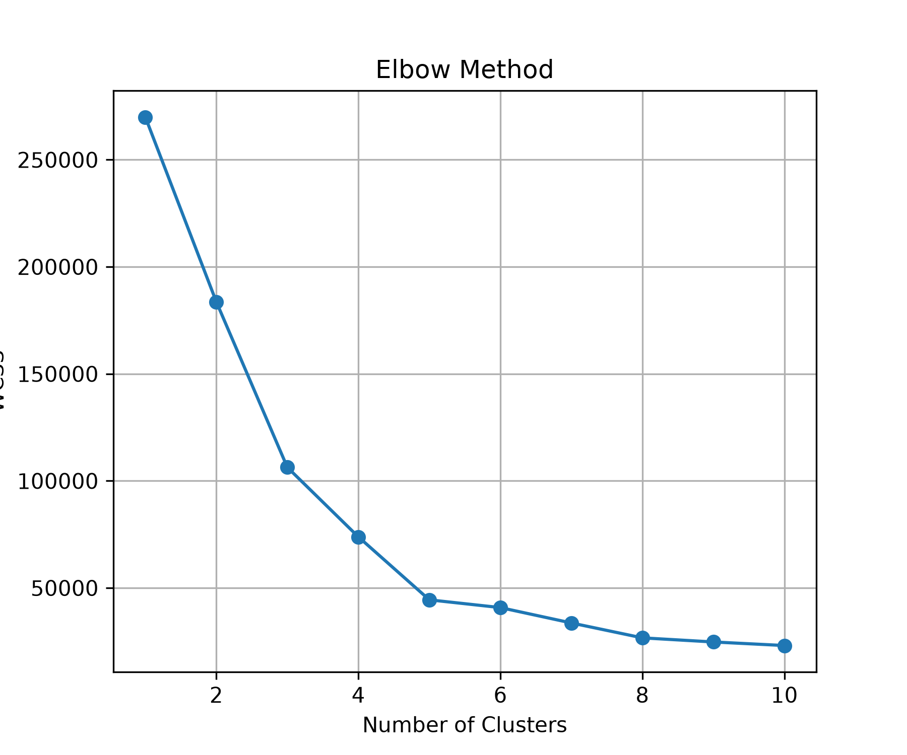
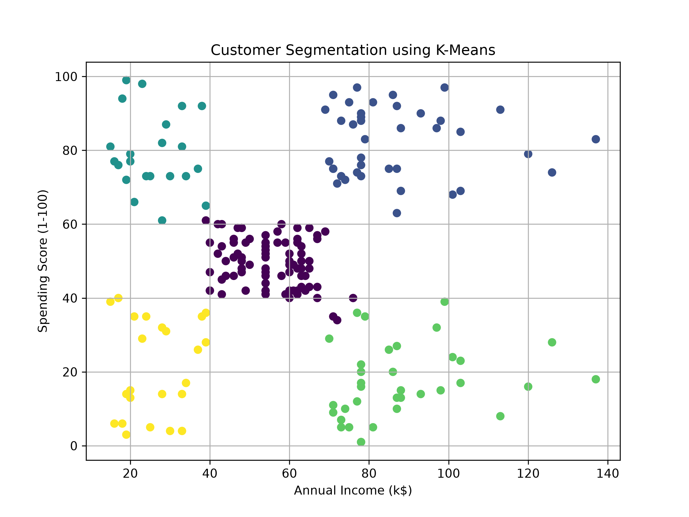

#  Customer Segmentation Using K-Means Clustering

<p align="center">
  <strong>SkillCraft Technology Internship · Task 2</strong>
</p>

<p align="center">
  A Machine Learning project that groups retail customers based on their annual income and spending behaviour.
</p>

---

##  Project Overview

This project uses the **K-Means Clustering** algorithm to group customers of a retail store into different clusters based on two features:

-  **Annual Income (k$)**
-  **Spending Score (1–100)**

The project uses clustering to identify customer groups and visualize the resulting segments.

##  Technologies Used

| Technology | Purpose |
|---|---|
| Python | Programming language |
| Pandas | Data handling and analysis |
| Matplotlib | Data visualization |
| Scikit-learn | Machine Learning and clustering |

##  Dataset

**Dataset Name:** Mall Customers Dataset

Location: `data/Mall_Customers.csv`

##  Workflow

The project follows these steps:

1. **Data Loading** — Loaded the customer dataset.
2. **Feature Selection** — Selected the required columns for clustering.
3. **Optimal Cluster Selection** — Used the Elbow Method to determine the number of clusters.
4. **Model Creation** — Created the K-Means clustering model.
5. **Customer Grouping** — Grouped customers into different clusters.
6. **Visualization** — Displayed the customer segmentation graph.

##  Project Output

### 1. Elbow Method

The Elbow Method graph is used to help determine the appropriate number of clusters for the K-Means model.

<p align="center">
  
</p>

### 2. Customer Segmentation

The customer segmentation graph displays the different clusters formed using Annual Income and Spending Score.

<p align="center">
  
</p>

##  Project Structure

```text
SCT_ML_2/
│
├── data/
│   └── Mall_Customers.csv
│
├── images/
│   ├── elbow_method.png
│   └── customer_segmentation.png
│
├── main.py
├── README.md
├── requirements.txt
└── .gitignore
```

---

<p align="center">
  <strong>SkillCraft Technology Internship · Task 2</strong>
  <br>
  Machine Learning | K-Means Clustering | Customer Segmentation
</p>
